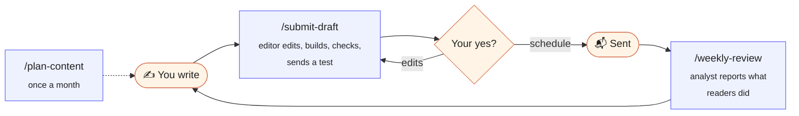

<div align="center">

# Beehiiv Starting Block

**A starting block is what a sprinter pushes off from. This is one for a newsletter.**

[](https://code.claude.com/docs)
[](https://www.beehiiv.com)
[](#who-does-what)
[](GUIDE.md)

[**Quick start**](#set-up) · [**How it works**](#the-weekly-loop) · [**Who does what**](#who-does-what) · [**Full guide**](GUIDE.md) · [**Example post**](posts/_example/)

</div>

---

**Starting Block** is a toolkit that runs in [Claude Code](https://code.claude.com/docs) and connects to [beehiiv](https://www.beehiiv.com) through the beehiiv MCP. It does two things:

1. **Sets beehiiv up from the newsletter you already have**, or from a ready-made look if this is your first, in one short session.
2. **Keeps you sending every week**, by taking over the planning, editing, building, checking and reporting around your writing.

**You write every post.** You signed up for a newsletter platform, after all. AI handles everything between "done writing" and "sent", and tells you afterwards what your readers did.

## Start here: `/start`

Everyone runs **`/start`** once. It walks you through configuration of the toolkit for your Beehiiv workspace.

If you're **already publishing**:

1. Drop **3–5 existing posts** into [`inbox/`](inbox/).
2. AI drafts your voice profile from your posts for you to approve.
3. You choose whether those posts are samples or get sent as your first Beehiiv publications.

If you're starting your **first newsletter:** name it, and write one sentence on what readers get.

- Next, you'll be introduced to the three agent roles that support your Beehiiv publishing journey, set up your newsletter look and feel, and choose publication categories so recommendations and sponsors can find you.
- Lastly, you'll set your weekly send slot (drafts are due two days before sending), plan your first four weeks of publishing, and end with one next action: usually your first post through `/submit-draft`.
- Your logo, style guide or brand colours aren't needed to start. Send them to the Publishing Lead whenever you like and it applies them.

From then on every post works the same way: **a draft goes into `inbox/` (or the chat), you run `/submit-draft`, and you approve what comes back.**

Nothing else is required to start sending. Signup forms, the welcome email, referrals and recommendations come when you're ready (see [Later](#later-when-youre-ready)).

## The weekly loop

The same three commands are used every week to keep publishing on track.


<sub>Warm boxes are you. Blue boxes are a command you run.</sub>

| When | You | Run | What happens |
|---|---|---|---|
| By your due date | Write your post. Save it in `inbox/` or paste it into the chat. | **`/submit-draft`** | The editor fixes plain errors, suggests a few numbered edits for you to accept or reject, offers three headlines and subject lines, builds the post in your beehiiv template, runs a pre-send checklist and sends you a test email. |
| When the test looks right | Say "schedule" | | It's scheduled for your slot. Nothing is ever scheduled without your yes. |
| A few days after sending | Read a one-screen report | **`/weekly-review`** | The analyst tells you what readers opened, clicked and ignored, compared with your own averages, and gives you one or two things to try next time. |
| Once a month | Say what you want to write about | **`/plan-content`** | The Publishing Lead lays out your next four weeks of articles. |

Target: **30 minutes a week or less** on everything that isn't writing.

## The content calendar

The content calender lives in [`ops/content-calendar.md`](ops/content-calendar.md) and follows these principles:

- **One article a week**, on a fixed send slot, the same day and time every week.
- **A draft due date** two days before each send, with reminders.
- **A working title for each week**, in your words.
- **Posts waiting in `inbox/` are slotted first.**
- **An ideas list**, topped up from reader replies and the weekly reports, for weeks without a title.
- **A streak**, tracked against what beehiiv says was sent.

If a draft is late, you're offered to submit what you have or write a short post (about 200 words). AI doesn't replace you by writing a post on your behalf.

## Set up

You need a beehiiv account and Claude Code. On beehiiv's 14-day Pro trial (no card needed) Claude can build and schedule drafts for you; on the Free plan it prepares everything and you paste it in.

```bash
git clone <your-copy-of-this-repo> my-newsletter
cd my-newsletter
claude
```

1. Approve the beehiiv server when Claude Code asks, run `/mcp`, choose **beehiiv** and sign in through your browser.
2. Run **`/start`**.

That's it. The repo is your newsletter's workspace from here on: your drafts, your calendar and a folder for every post you send.

## Later, when you're ready

These are left out of getting started on purpose. Each is one command, run when it's useful and not before. The Publishing Lead suggests each one once, at the right moment.

| Command | When | What it does |
|---|---|---|
| **`/capture-voice`** | First newsletter: after two or three posts. Anyone: to refresh | Builds your voice profile from the posts you've written, so the editor knows which of your habits to protect. If you brought posts to `/start`, you already have one. |
| **`/grow-audience`** | Once you're sending every week | Your choice of: welcome email (you write it), subscribe form and exit pop-up, a one-question signup survey, a referral program, and recommendations. |

## Who does what

> **You write. AI prepares, checks and reports.**

| Role | Where it lives | Job |
|---|---|---|
| **You** | | Write every post. Accept or reject each edit. Approve every send. |
| **Publishing Lead** | [`CLAUDE.md`](CLAUDE.md), your main session | Gets you started, plans with you, reminds you, coordinates, schedules only after your yes |
| **editor** | [`.claude/agents/editor.md`](.claude/agents/editor.md) | Takes your draft through editing, packaging, the beehiiv build, checks and the test email |
| **analyst** | [`.claude/agents/analyst.md`](.claude/agents/analyst.md) | Reads your numbers and reports what readers responded to. Read-only. |

What the system holds itself to:

- Your original draft is saved untouched and never modified. Every difference in the final text traces to a fix that was listed or an edit you approved.
- The editor adds no claims, examples or paragraphs of its own. An unclear fact becomes a question to you.
- Nothing is scheduled without a fresh yes from you. Automations and forms are built as drafts for you to switch on.
- Reports compare you only with your own averages, and call something a pattern only when two or more posts show it.

## Plans

The Publishing Lead works out what your plan allows when you start, and adjusts. During the Pro trial beehiiv still reports your plan as Free, so the Lead doesn't trust the plan name: it makes one harmless test save (your publication name, unchanged) and goes by whether beehiiv accepts it.

| Plan | What Claude can do through the MCP | How you work |
|---|---|---|
| **Free** | Read only | The editor hands you a finished post and its details; you paste into beehiiv and schedule. Your voice and standards guides stay in the repo until you upgrade. Reports work as normal. |
| **14-day Pro trial** | Build drafts, templates and themes; schedule | Everything runs from Claude. A good window for `/start` and your first two posts. |
| **Lite** | Build drafts, templates and themes | You schedule in the beehiiv app, about two minutes. |
| **Pro** | Everything in Lite, plus scheduling | Claude schedules after you say yes. |

## What's in the repo

```
├── README.md                 You are here
├── GUIDE.md                  The full playbook: how it works and why
├── CLAUDE.md                 Publishing Lead instructions
├── .mcp.json                 beehiiv MCP connection
├── .claude/
│   ├── agents/               editor · analyst
│   └── skills/               start · plan-content · submit-draft · weekly-review
│                             capture-voice · grow-audience
├── inbox/                    Where every post starts. Drop drafts (and old posts) here.
├── posts/                    One folder per post sent; _example/ is a complete fictional sample
├── ops/                      content-calendar · ideas · learnings · replies · reports/
├── brand-styles/             clean · editorial · bold, plus preview.html
├── beehiiv-skills/           Starter voice and publishing standards, uploaded to beehiiv
├── templates/                Formats the agents fill in, the post template skeleton, the welcome automation
├── config/                   publication.example.yaml → your settings
└── scripts/weekly-run.sh     Draft reminders and the weekly review, unattended
```

Every post you send leaves a folder behind, `posts/<send-date>-<slug>/`: your original draft, the edit notes and your decisions, the final text, the publishing details, the pre-send checklist, and later the results. See [`posts/_example/`](posts/_example/) for one filled in.

## Why it's built this way

- **You're the writer.** Audiences appreciate your voice. The toolkit can't replace you but does save you time at every other step.
- **The goal is to create a sending habit.** Newsletters die when the writer stops sending. The toolkit helps build a weekly sending habit to drive subscriber growth.
- **Beehiiv is the system of record.** Your personal toolkit holds plans and history; what was sent and how it performed is always read from Beehiiv.

## Out of scope

Not covered at this time: earning money from your newsletter. That can come later if this toolkit proves helpful.
